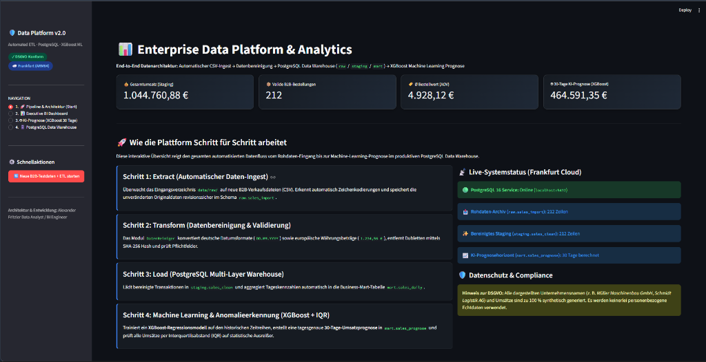
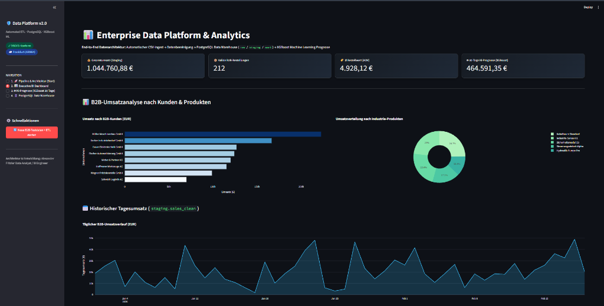
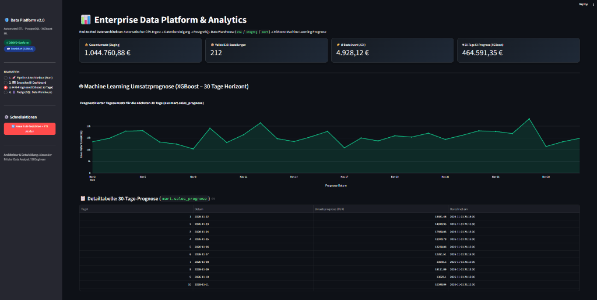
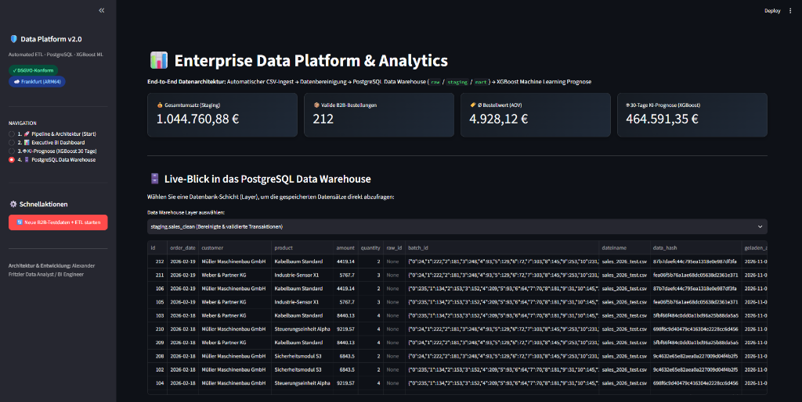
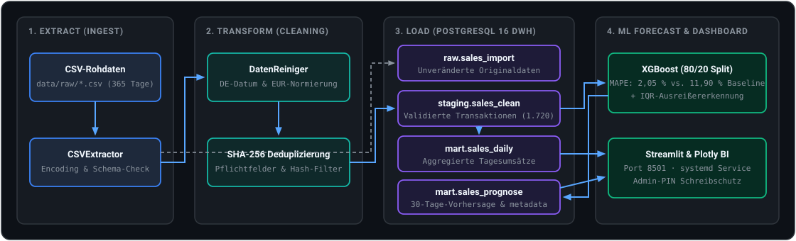

# 📊 B2B Sales Data Platform v2.0 — ETL, PostgreSQL DWH & XGBoost Forecasting

[](https://www.python.org/)
[](https://www.postgresql.org/)
[](https://xgboost.readthedocs.io/)
[](http://89.168.112.220:8501)
[](LICENSE)

> **Kurzbeschreibung:** CSV-Ingest → PostgreSQL-DWH (`raw` / `staging` / `mart`) → XGBoost-Prognose → Streamlit, live auf Oracle Cloud Frankfurt.
>
> 🌐 **Live-Demo im Browser öffnen:** [**http://89.168.112.220:8501**](http://89.168.112.220:8501)  
> *(Hinweis: Im öffentlichen Demo-Modus ist der manuelle ETL-Trigger in der Seitenleiste durch eine Admin-PIN geschützt, um die Datenbank vor unbefugtem Überschreiben zu schützen. Lokal ist die Funktion frei ausführbar.)*

---

## 🎯 Projektüberblick & Datenbasis

Dieses Showcase-Projekt demonstriert eine durchgängige Data-Engineering- und ML-Pipeline für B2B-Verkaufstransaktionen:

* **Datenbasis:** Ausschließlich synthetisch generierte B2B-Transaktionsdaten (**1.720 Bestellungen über 365 Tage**), keine personenbezogenen Daten (`generate_test_data.py`).
* **4-Schritt-ETL-Pipeline:** Automatischer CSV-Ingest, Normierung deutscher Datums- (`DD.MM.YYYY`) und Währungsformate (`1.234,56 €`), SHA-256-Deduplizierung und Laden in PostgreSQL 16.
* **Data Warehouse Schichtenmodell:** Saubere Trennung zwischen `raw.sales_import`, `staging.sales_clean`, `mart.sales_daily` und `mart.sales_prognose` sowie Audit-Logging in `metadata.etl_log`.
* **Zeitreihen-Prognose (XGBoost):** 30-Tage-Umsatzprognose mit chronologischer Out-of-Time-Validierung (80 % Training / 20 % Holdout-Test).

---

## 📐 Modellgüte & Validierung (XGBoost)

Chronologischer Out-of-Time-Split: 80 % Training (`292 Tage`) / 20 % Holdout-Test (`73 Tage`).  
Als Referenz dient eine naive Baseline (letzte Trainingswoche wird zyklisch wiederholt).

| Modell | MAPE (Holdout) | MAE (Holdout) |
| :--- | :--- | :--- |
| **Naive Baseline (7-Tage-Muster)** | `11,90 %` | `1.542,10 €` |
| **XGBoost** | **`2,05 %`** | **`276,29 €`** |

> **Hinweis:** Alle Kennzahlen beziehen sich auf synthetisch generierte Daten mit definierter Saisonalität und Trend (`generate_test_data.py`). Sie belegen die Funktionsfähigkeit der Pipeline, nicht die Prognosegüte auf Realdaten.

Reproduzierbar mit: `python src/baseline.py`

---

## 📸 Screenshots der Anwendung

### 1. Pipeline-Architektur & Systemstatus


### 2. BI Umsatz-Dashboard (Kunden, Produkte & Tagesverlauf)


### 3. XGBoost 30-Tage-Prognose & Modellgüte


### 4. PostgreSQL Data Warehouse Explorer (`staging` / `mart` / `raw`)


### 5. CLI-Ausführung des ETL-Orchestrators (`orchestrator.py`)
```text
2026-11-02 01:22:10 | INFO | 🔄 ETL START  Batch: 19a44ca3
2026-11-02 01:22:10 | INFO | 📁 1 CSV-Datei(en) gefunden in: data/raw (sales_b2b_365d.csv: 1720 Zeilen)
2026-11-02 01:22:10 | INFO | 🧹 Bereinigung fertig: 1720 → 1720 Zeilen (SHA-256 geprüft)
2026-11-02 01:22:10 | INFO | 💾 Geladen → raw: 1720 | staging: 1720 | mart.sales_daily: aktualisiert
2026-11-02 01:22:11 | INFO | 🤖 Prognose mit 365 historischen Tagen, Horizont: 30 Tage
2026-11-02 01:22:11 | INFO |    XGBoost (80/20 Split: 292 Train / 73 Test Tage) -> MAE: 276.29 € | MAPE: 2.05 %
2026-11-02 01:22:11 | INFO | ✅ Modell: XGBoost | 30-Tage-Summe: 425040 € | Test-MAE: 276.29 € | Test-MAPE: 2.05 %
2026-11-02 01:22:11 | INFO | 💾 30 Zeilen → mart.sales_prognose (replace)
2026-11-02 01:22:11 | INFO | ✅ ETL FERTIG  Dauer: 1.8s
```

---

## 🏗️ Systemarchitektur & Datenfluss



---

## 🚀 So startest du das Projekt lokal (in 5 Minuten)

### Option A: Schnellstart mit Docker Compose (Empfohlen für PostgreSQL)

```bash
# 1. Repository klonen
git clone https://github.com/alefritz19/Enterprise-Data-Platform-v2.git
cd Enterprise-Data-Platform-v2

# 2. Umgebungsvariablen anlegen
cp .env.example .env

# 3. PostgreSQL 16 inkl. DWH-Schemata (init_db.sql) per Docker starten
docker compose up -d

# 4. Virtuelle Python-Umgebung erstellen & Abhängigkeiten installieren
python3 -m venv venv
source venv/bin/activate  # Windows: venv\Scripts\activate
pip install -r requirements.txt

# 5. Synthetische 365-Tage-Daten erzeugen & ETL + XGBoost ausführen
python generate_test_data.py
python orchestrator.py

# 6. Streamlit-Dashboard lokal starten (http://localhost:8501)
streamlit run dashboard.py
```

### Option B: Mit lokal installiertem PostgreSQL (ohne Docker)

```bash
psql -U postgres -c "CREATE DATABASE data_platform;"
psql -U postgres -d data_platform -f src/database/init_db.sql
python generate_test_data.py && python orchestrator.py
streamlit run dashboard.py
```

---

## 📂 Projektstruktur

```text
Enterprise-Data-Platform-v2/
├── assets/                        # Screenshots der Live-Anwendung
├── config/
│   ├── database.yaml              # Datenbank-Verbindungsparameter & Pooling
│   └── etl_config.yaml            # ETL-Regeln, Datumsformate & ML-Parameter
├── data/
│   ├── raw/                       # Eingangsverzeichnis für CSV-Dateien
│   ├── processed/                 # Archiv & model_metrics.json (80/20 Validierung)
│   └── errors/                    # Quarantäne-Verzeichnis für fehlerhafte Dateien
├── src/
│   ├── database/
│   │   ├── init_db.sql            # DDL-Skript (Schemata: raw, staging, mart, metadata)
│   │   └── postgres_connector.py  # SQLAlchemy-Engine & Verbindungsmanagement
│   ├── extract/
│   │   └── csv_extractor.py       # Robuster CSV-Reader mit Encoding-Erkennung
│   ├── transform/
│   │   └── data_cleaner.py        # Bereinigung, Typkonvertierung & SHA-256-Deduplizierung
│   ├── load/
│   │   └── postgres_loader.py     # Mehrschichtiges Laden in PostgreSQL
│   ├── ml/
│   │   ├── forecaster.py          # XGBoost-Prognose mit chronologischem 80/20-Split
│   │   └── anomaly_detector.py    # Statistische Ausreißererkennung (IQR)
│   ├── alerts/
│   │   ├── telegram_admin.py      # Optionale Admin-Benachrichtigungen via Telegram
│   │   └── email_kunde.py         # Optionaler HTML-Berichtsversand via SMTP
│   └── utils/
│       ├── config.py              # YAML- & .env-Konfigurationslader
│       └── logger.py              # Strukturiertes Datei- & Konsolen-Logging
├── dashboard.py                   # Streamlit & Plotly Dashboard (mit Admin-PIN-Schutz)
├── docker-compose.yml             # 1-Klick PostgreSQL-16-DWH Setup inkl. Schema-Init
├── generate_test_data.py          # Synthetischer 365-Tage B2B-Datengenerator
├── orchestrator.py                # Zentraler ETL- & ML-Pipeline-Orchestrator
├── requirements.txt               # Python-Abhängigkeiten
├── LICENSE                        # MIT-Lizenz
└── README.md                      # Projektdokumentation
```

---

## 👤 Autor & Kontakt

**Alexander Fritzler**  
*Cloud Data & Business Intelligence Engineering*  
📍 Baden-Württemberg, Deutschland  
🔗 [GitHub-Profil (@alefritz19)](https://github.com/alefritz19)
